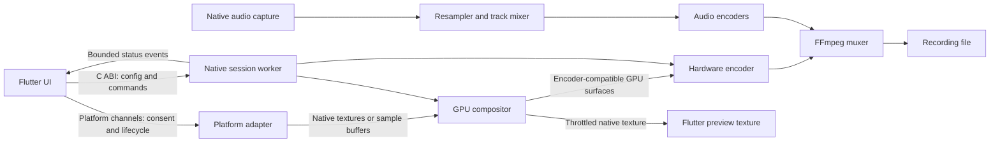

# Architecture decision: Rust + Flutter + native media adapters

This document preserves the Phase 1 target design. Planned markers below describe
that original layout, not current feature availability. See [release status](release-status.md)
for the implemented Windows capture/audio/UI modules and remaining work.

Use Rust for session orchestration, timestamps, media graphs, resource ownership,
capability selection and FFmpeg integration. Use Flutter for Windows/macOS and
Android/iOS interfaces. Flutter compiles to native applications without a web
view, but renders its own widgets; it is not a wrapper around every OS widget.
Keep the capture process independent of UI rendering so Flutter's baseline memory
and preview work can be measured, minimized, or avoided in headless recording.
A future Qt desktop host can consume the same C ABI if measured UI memory costs
justify a second UI implementation.

The initial code uses Rust's `ffmpeg-sys-next` bindings. Small unsafe modules own
FFmpeg contexts and frames; application configuration and control logic stay
safe. Memory safety does not follow automatically from choosing Rust: every
native resource, callback, buffer reference, device fence and FFI boundary needs
an explicit ownership contract.

## Complete target monorepo

`[P]` means planned. Unmarked files/modules below already exist. The target layout
is comprehensive without creating fake implementations of future features.

```text
screenrecorder/
├── Cargo.toml                         Rust workspace and FFmpeg linkage
├── Cargo.lock                         [P] generated after verified resolution
├── LICENSE
├── README.md
├── .gitignore
├── .github/workflows/                 [P] pinned-SDK builds and device tests
├── core/
│   ├── recorder-api/
│   │   ├── Cargo.toml
│   │   └── src/lib.rs                 Config + container definitions
│   ├── recorder-engine/
│   │   ├── Cargo.toml
│   │   ├── src/
│   │   │   ├── lib.rs
│   │   │   ├── error.rs
│   │   │   ├── frame.rs               CPU AVNuvyrec ownership
│   │   │   ├── output.rs              Seekable file IO callbacks
│   │   │   ├── session.rs             Encoder + muxer lifecycle
│   │   │   ├── capture/               [P] capture traits and source negotiation
│   │   │   ├── gpu/                   [P] shared surfaces, pools and fences
│   │   │   ├── compositor/            [P] crop/scale/chroma key/annotations
│   │   │   ├── audio/                 [P] resampling, mixer, tracks, drift
│   │   │   ├── encoder/               [P] backend probes and typed settings
│   │   │   ├── muxer/                 [P] audio/video mux, segmentation
│   │   │   ├── export/                [P] GIF palette conversion/remux
│   │   │   ├── scheduler/             [P] clocks and bounded work queues
│   │   │   └── adaptive/              [P] load controller and telemetry
│   │   ├── examples/synthetic.rs
│   │   └── tests/session_lifecycle.rs
│   ├── recorder-ffi/
│   │   ├── Cargo.toml
│   │   ├── include/recorder.h
│   │   └── src/lib.rs                 Versioned C ABI bootstrap
│   └── recorder-cli/                  [P] headless recording/benchmark commands
├── platform/
│   ├── README.md
│   ├── windows/                       [P] Rust windows bindings + D3D11
│   │   ├── capture/                   WGC, DXGI fallback
│   │   ├── audio/                     WASAPI loopback and mic
│   │   └── camera/                    Media Foundation
│   ├── macos/                         [P] Objective-C/Swift interop
│   │   ├── capture/                   ScreenCaptureKit
│   │   ├── gpu/                       Metal/CVPixelBuffer ownership
│   │   └── audio-camera/              Core Audio and AVFoundation
│   ├── android/                       [P] Kotlin service + JNI bridge
│   │   ├── projection/                Consent, lifecycle, VirtualDisplay
│   │   ├── media/                     MediaCodec, AudioRecord, EGL
│   │   └── jni/                       Rust worker ingress
│   └── ios/                           [P] Swift adapters
│       ├── capture/                   In-app ReplayKit
│       ├── broadcast-extension/       Separate ReplayKit capture process
│       └── media/                     VideoToolbox/Metal/audio
├── packages/
│   ├── recorder_bridge/
│   │   ├── pubspec.yaml
│   │   └── lib/recorder_bridge.dart    Actual C ABI discovery binding
│   ├── recorder_capture/              [P] federated Flutter native plugin
│   │   ├── lib/                       Channels and capability models
│   │   ├── windows/                   Native texture registrar integration
│   │   ├── macos/                     Native texture + permissions
│   │   ├── android/                   Kotlin channels and service
│   │   └── ios/                       Swift channels and extension coordination
│   ├── recorder_models/               [P] typed UI settings/events
│   └── recorder_widgets/              [P] shared controls and theme
├── apps/
│   ├── desktop/
│   │   ├── README.md
│   │   ├── pubspec.yaml               [P]
│   │   ├── lib/                       [P] source picker/settings/preview
│   │   ├── windows/                   [P] Flutter desktop runner
│   │   └── macos/                     [P] Flutter desktop runner
│   └── mobile/
│       ├── README.md
│       ├── pubspec.yaml               [P]
│       ├── lib/                       [P] permission/start/stop UI
│       ├── android/                   [P] Flutter mobile runner
│       └── ios/                       [P] runner + extension targets
├── shaders/                           [P] HLSL/Metal/GLSL + shared test vectors
├── tests/
│   ├── integration/                   [P] permission, source and recovery tests
│   ├── media-fixtures/                [P] color/audio/timestamp fixtures
│   └── performance/                   [P] reproducible device workload suite
├── tools/
│   ├── verify.ps1
│   ├── ffmpeg/                        [P] pinned per-platform SDK recipes
│   └── packaging/                     [P] installers, signing, native assets
├── artifacts/                         generated, ignored
└── docs/
    ├── architecture.md
    ├── build.md
    ├── roadmap.md
    └── adr/                           [P] design decisions and benchmark evidence
```

## Control plane versus media plane



### Flutter ↔ Rust

`dart:ffi` calls a small C ABI exported by Rust `cdylib` on desktop/Android and
`staticlib` on iOS. Expose fixed-width integers, versioned structs with a size
field, and opaque numeric session IDs. Do not expose Rust types or `AVNuvyrec*`.
Generate larger bindings from the checked-in C header using ffigen; the current
one-function binding is handwritten. Flutter's current guidance describes native
build hooks for FFI packaging; the Rust build still needs explicit integration.
See [Flutter FFI](https://docs.flutter.dev/platform-integration/bind-native-code).

Phase 2 command contract: `create(config) → id`, `start(id)`, `pause(id)`,
`resume(id)`, `stop(id)`, `poll_event(id)` and `destroy(id)`. Those functions are
**design proposals, not exported symbols yet**. Validate data before enqueueing
commands. Copy input strings during the call; borrowed Dart memory must never be
retained. Use a bounded queue and return BUSY rather than block the UI isolate.
Stop completion means encoder flush, trailer, IO check and file close completed;
destroy joins the worker after stop or cancellation. IDs include generations to
reject stale handles. Panic containment converts recoverable Rust unwinds to
status errors; memory faults/abort/OOM are not recoverable panics.

Create FFmpeg contexts inside their worker so their owning Rust session never
crosses threads. Native capture callbacks hand over reference-counted surfaces
through bounded queues, never mutable aliases. UI events run at 5–10 Hz; audio
meters and preview are independently throttled. Poll small event records or use
Dart native ports from workers; never call an ordinary Dart FFI callback from an
arbitrary media thread. Qt can call the same ABI and dispatch events to its GUI
thread without changing the engine.

### Flutter ↔ Kotlin/Swift

Use MethodChannel/Pigeon messages for OS consent, source pickers, lifecycle and
service/extension coordination, and an EventChannel for permission revocation.
Respect platform thread rules. Native adapters invoke Rust through JNI on Android
and the C ABI on Apple platforms. Nuvyrecs remain native. Previews use Flutter's
texture registrar; ownership and renderer compatibility may require an extra GPU
copy, but must not trigger a full-frame Dart/CPU pixel round trip.
See [platform channels](https://docs.flutter.dev/platform-integration/platform-channels).

The iOS broadcast extension is a separate process with its own small native
worker and FFmpeg/VideoToolbox resources. Share settings/status using an App Group
or supported IPC; process-local session IDs and pointers cannot be shared. Do not
embed Flutter in that extension. App termination and extension termination are
independent lifecycle events.

## Platform capture and feature availability

| Platform | Video path | Audio path | Capability limits |
|---|---|---|---|
| Windows | WGC → D3D11 texture; DXGI duplication fallback for displays | WASAPI loopback + microphone | Window support differs by backend; protected content is unavailable |
| macOS | ScreenCaptureKit → IOSurface/CVPixelBuffer → Metal | Supported screen audio + native microphone capture | Consent, OS version and selected source determine availability |
| Android | MediaProjection → Surface/EGL → MediaCodec input surface | AudioPlaybackCapture + AudioRecord microphone | Per-session consent, foreground service, source-app audio policy |
| iOS | ReplayKit sample buffers → CVPixelBuffer/VideoToolbox; broadcast extension for cross-app recording | ReplayKit app/mic samples | No arbitrary desktop-style window picker or unrestricted other-app overlay |

WGC provides display/window frames in a Direct3D frame pool; Vulkan is not itself
a Windows screen-capture API. D3D11 is the initial Windows device model because it
matches capture and encoder interop. Introduce Vulkan only where interoperability
is measured and worthwhile. See [Windows capture](https://learn.microsoft.com/en-us/windows/apps/develop/media-authoring-processing/screen-capture).

ScreenCaptureKit streams screen content and audio; ReplayKit is the iOS recording
and broadcast foundation. See [ScreenCaptureKit](https://developer.apple.com/documentation/screencapturekit)
and [ReplayKit](https://developer.apple.com/documentation/replaykit).

Android screen capture requires MediaProjection lifecycle handling and user
consent. Playback audio capture is subject to the producing app's capture policy,
audio usage, permissions and user profile. Advertise capabilities rather than
promise every app's system audio. See [MediaProjection](https://developer.android.com/media/grow/media-projection)
and [audio playback capture](https://developer.android.com/media/platform/av-capture).

Custom regions are crops of an authorized source: transform logical/DPI-scaled
selection coordinates into source pixels, clamp them and align dimensions for
the negotiated chroma format. On iOS, an output crop does not provide arbitrary
window selection. Desktop annotation uses a transparent input window plus vector
strokes rendered once into the recorded compositor; avoid capturing and drawing
the same overlay twice. Cross-app on-screen drawing is not uniformly available
on mobile. Separate recorded annotations from OS overlay visibility.

## GPU resource and encoder design

The target is **no CPU readback in the hardware capture/encode path**. GPU crop,
scale, color conversion and overlays can still need GPU writes or copies. BGRA
capture cannot simply be handed to every H.264 encoder: convert to NV12, or P010
for an explicitly supported HDR/10-bit pipeline. The Phase 1 synthetic CPU path
copies YUV planes and makes no zero-copy claim.

Each native frame carries source ID, monotonic timestamp, device/adapter identity,
dimensions, pixel/color metadata, reference-counted surface and completion fence.
The compositor retains the source until GPU reads complete; the encoder retains
its output surface until encoding completes. Recycle pooled textures only after
those fences/references are released. Never hold a capture callback while waiting
for disk IO. Start with 3–4 surfaces and an explicit byte budget; distinguish
surface pool capacity from queued frames and retained encoder references.

Prefer same-adapter capture/composition/encoding. Cross-adapter copies and surface
imports can fail or cost bandwidth. Probe capture API, device, encoder, import
format, maximum dimensions/frame rate, driver support, session limits and actual
encoder initialization. A listed encoder is not proof that the installed device
can use it.

Windows probes FFmpeg `h264_nvenc`, `h264_amf` and `h264_qsv` using backend-specific
device contexts/import requirements. Choose among working candidates using user
preference and measured load, not one universal vendor ordering. AMD/Intel/Nvidia
paths do not share identical settings or surface formats. macOS/iOS use
VideoToolbox; Android uses MediaCodec. Allow native encoding with FFmpeg packet
muxing where it avoids an unnecessary surface round trip. A software H.264 path
is an explicit fallback with disclosed capture/conversion costs.

Do not assume enabling an FFmpeg hardware encoder by name establishes a GPU
pipeline. The later backend layer must configure AVHWDeviceContext,
AVHWNuvyrecsContext or equivalent native encoder resources, import the right
surface type, and validate the entire capture-to-encoder path.

## Low-end and high-end performance policy

"Flawless on every low-end PC" and "4K/120 on every high-end PC" are not realistic
acceptance criteria. Define minimum supported hardware and benchmark each driver,
encoder and storage combination. 4K/120 is a negotiated capability and a measured
target. Uncompressed 4K BGRA alone is roughly 31.6 MiB per surface; four surfaces
consume about 126.6 MiB before NV12 buffers, preview, driver allocations or UI.
Choose pool sizes from memory budgets rather than resolution-independent defaults.

Initial controller policy (planned, tune with measurements):

1. Measure encode latency, GPU completion time, frame age, queue occupancy, CPU
   load, memory, thermal state and disk write stalls in rolling windows.
2. If frames remain late for two seconds, reduce preview work/optional effects,
   then reduce capture frequency. Keep bounded queues; drop stale video frames
   while preserving timestamps. Never silently drop audio to relieve video load.
3. Reduce bitrate for disk pressure or codec-specific throughput issues. Lower
   bitrate alone does not meaningfully reduce the pixel work on a weak GPU.
4. Scale the captured content within a fixed encoded canvas for instant visual
   quality adjustment, or close the segment and reopen the encoder/muxer at a
   lower coded resolution. Do not mutate AVCodecContext dimensions midstream and
   assume a normal MP4 track will remain compatible.
5. Apply supported runtime bitrate changes only through the selected backend's
   reconfiguration API; otherwise restart at a segment boundary. Use hysteresis,
   a cooldown, and ten seconds of headroom before upgrading quality.

Suggested starting presets, not verified guarantees: 720p/24–30 with preview off
for constrained machines; 1080p/60 for balanced machines; 4K/60 or 120 only after
device and sustained-storage tests. Expose dropped frames and the reason for
quality changes. Stop with an explicit error if no sustainable profile exists.

## Audio, overlays and containers

Use one monotonic recording clock. Map platform capture times into it; maintain
video PTS and audio sample-count timestamps separately. Pause removes the same
interval from both timelines. Resample to a common mix format (initially 48 kHz
float stereo), correct drift gradually, and keep bounded audio buffers. Preserve
separate system and microphone tracks plus an optional mixed track. Gains, mute,
ducking, limiting and clipping indicators operate on the mix bus, not the saved
isolated tracks unless selected. Phase 1 has no audio stream or resampler yet.

Webcam sources are independent native capture producers. Composite crop/scale,
chroma key and annotations on the GPU before encoder input. Handle camera loss
without stopping screen recording. Bound shader complexity on low-end machines.
SDR BT.709 is the reference path; HDR requires explicit tone mapping or a fully
negotiated 10-bit color pipeline, never an implicit metadata-only conversion.

| Output | Planned production use | Caveat |
|---|---|---|
| MKV | Recording default, multiple H.264/AAC or Opus tracks | Better interruption tolerance; still verify/finalize IO |
| MP4 | H.264/AAC export and optionally fragmented recording | Conventional MP4 needs final metadata; use remux from MKV for recovery workflow |
| AVI | Legacy compatibility profiles | Codec, timestamp, size and multi-track player compatibility need explicit tests |
| GIF | Offline trimmed/downscaled palette export | No audio; unsuitable as the main 4K/high-fps recording target |

The initial encoder is MPEG-4 Part 2 for dependency-light initialization checks;
it is not H.264 and may not play in every hardware-only player. Container support
does not imply codec/player compatibility. Encode packets, rescale their time
bases to the stream time bases chosen after header writing, interleave, drain and
finalize explicitly. FFmpeg's [muxing lifecycle](https://ffmpeg.org/doxygen/8.0/group__lavf__encoding.html)
defines those responsibilities; custom AVIO ownership is documented in
[FFmpeg 8 AVIO](https://ffmpeg.org/doxygen/8.0/avio_8h.html).

## Error recovery and distribution

State machine: Idle → Preparing → Recording ↔ Paused → Stopping → Stopped;
any active state can enter Failed. Permission revocation, device loss, source
resize, insufficient disk space and encoder failure emit actionable events.
Do not mix frames from old/new source sizes without controlled conversion or
renegotiation. Keep partial recordings on failure and report recovery options.
The implemented session has the smaller Ready/Failed/Finished lifecycle.

Limit settings sizes and allocations at all public boundaries, constrain queues,
sanitize output metadata, and never hide fallback behavior. Distribution must
bundle matched native libraries, respect platform signing/entitlements and track
the actual FFmpeg configure flags. MIT licensing of our code does not override
FFmpeg's dependency licenses. See [FFmpeg licensing](https://ffmpeg.org/legal.html).
